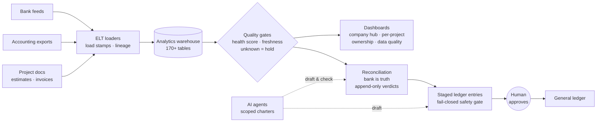

<h1 align="center">James Nguyen</h1>

<b>Finance and Operation Analyst · I build the systems finance and operations run on</b>

  
  
  
  

  
  

Accountant turned builder. 10+ years in accounting and reconciliation and 13 years running my own business. Now I'm the in-house developer at a commercial solar and storage contractor, where I designed and run the company's finance and operations platform end to end.

---

## The platform I built (private, case study)

> An AI-assisted finance and operations platform for a commercial solar contractor. I designed it and direct the build. The code and data are private, so this shows how it works, not what's in it.

<table>
<tr>
<td align="center"><h2>170+</h2>warehouse tables</td>
<td align="center"><h2>~50</h2>automated loaders</td>
<td align="center"><h2>~150</h2>daily pipeline steps</td>
<td align="center"><h2>~20</h2>chartered AI agents</td>
<td align="center"><h2>1,000+</h2>issues tracked to closed</td>
<td align="center"><h2>~2,500</h2>automated tests</td>
</tr>
</table>

**What it does**

| Area | What I built |
|---|---|
| 🗄️ **Data architecture** | One governed analytics warehouse that replaced scattered spreadsheets. Every table carries its source, load time, owner and a data-quality health score. |
| 🏦 **Reconciliation** | Bank-first matching of every bank transaction to the ledger. Verdicts are append-only, so the audit trail can't be overwritten. |
| 🧾 **Ledger automation** | Purchase orders, bills, invoices and payments generated as import files behind a fail-closed validation gate. A person approves every posting. |
| 📊 **Dashboards** | A company operations hub, a page for each active project (budget → POs → spend → milestones), and system-health boards, all rebuilt from the warehouse every day. |
| ⚙️ **Pipeline** | A scheduled daily run of ~150 steps that records every step's status, so a partial run never passes for a complete one. |
| 🤖 **AI operations** | ~20 Claude Code agents, each scoped to one job (books, bank, projects, tax, data quality, dashboards). Ownership registry, issue register and a decision log of 240+ rulings. Agents propose; a human approves money, tax and anything external. |
| 🛡️ **Controls** | Pre-commit gates for secrets and unsafe changes, rolled out report-only first, then enforced. |

**Principles:** Unknown is a valid answer · The bank is the source of truth · A person approves · Check the output, not the exit code

---

## Public projects

<table>
<tr>
<td width="50%" valign="top">
<b>🎬 Cinemetrics</b> 
Find movies, TV and games: trending, where to stream, what's playing near a ZIP code. No framework. SavvyCoders capstone, still maintained (100+ commits). 
   
<a href="https://capstonesavvycoders.netlify.app/">Live</a> · <a href="https://github.com/jamesmnguyen704/CapstoneSavvyCoders">Code</a>
</td>
<td width="50%" valign="top">
<b>🥛 No-Whey</b> 
Checks ingredient lists for dairy and returns SAFE, UNSAFE or REVIEW REQUIRED with the reason. Rules live in readable YAML. 
  
<a href="https://no-whey.onrender.com">Live</a>
</td>
</tr>
<tr>
<td width="50%" valign="top">
<b>🎣 Bait &amp; Switch</b> 
A Midwest fishing map: 200+ curated waters, a live Illinois DNR depth overlay and OpenStreetMap boat ramps. 
   
<a href="https://bait-and-switch-ruddy.vercel.app">Live</a>
</td>
<td width="50%" valign="top">
<b>📈 TripleTen Data Science</b> 
16 projects: EDA, hypothesis testing and ML. Churn prediction with CatBoost (AUC-ROC 0.844) and a CNN that estimates age from photos (~7-year MAE). 
   
<a href="https://github.com/jamesmnguyen704/TripleTenProgram">Code</a> · <a href="https://jamesnguyen.netlify.app">Portfolio</a>
</td>
</tr>
</table>

---

## Toolbox

**Data**      

**AI**     

**Web**      

**Finance**     

**Credentials:** BA Accounting · Data Science, TripleTen (2024) · Full Stack Web Dev, SavvyCoders (2025) · Anthropic Academy: Claude Code, MCP, AI Fluency, Cowork

  
  

<!--
PICTURES TO ADD (save into the profile repo as /img/*.png):
- cinemetrics.png, nowhey.png, baitswitch.png: a screenshot of each live site (Win+Shift+S).
- tripleten-chart.png: one chart from a TripleTen notebook (e.g. the ROC curve).
- dashboard-demo.png: NEVER a real work screenshot. Only a dashboard rebuilt with fake data, or skip it. The mermaid diagram above already renders as a picture on GitHub.
Then swap each "IMG: x.png" line for: 
-->
